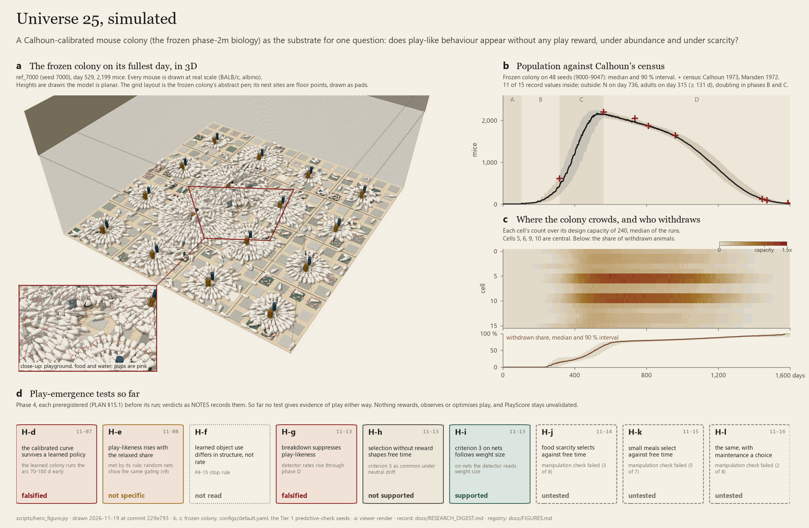

# universe25-play



<sub>The hero figure is remade by `scripts/hero_figure.py`. What each panel shows, and what it does
not claim: [docs/FIGURES.md](docs/FIGURES.md). An introduction for readers outside the
repo: [docs/booklet/universe25_booklet.pdf](docs/booklet/universe25_booklet.pdf) (nine pages).</sub>

Research-grade **Universe 25** (Calhoun 1973) simulation with an optional **playground** zone.

Track E / exploratory. Agents are need-driven (hunger, thirst, fatigue, stress, social, aggression, maternal, curiosity, boredom, homeostasis). **There is no play reward.** The playground is geometry + manipulable objects only; any playground use is drive spillover.

## Status (2026-11-17)

| part | state |
|---|---|
| **Substrate** (phase 1) | Need-driven mice in Calhoun's 101 × 101 in pen: 16 cells, 256 nest boxes, food and water, and a playground of balls, tunnels and ramps. |
| **Calibration** (phase 2) | Frozen at phase 2m. On the 48 seeds of the Tier 1 predictive check, 12 of the record's 15 values fall inside the 90 % prediction interval. The misses are N on day 736 and the doubling times of phases B and C: the colony grows too fast. The collapse emerges from the mechanisms; its irreversibility is a model assumption fitted to one colony. |
| **Replica v2** | Calhoun's own pen layout: triangular cells, tunnels and box levels. It ended on 2026-11-13. The final replica has 10 of 20 pen targets inside and the arc in 45 of 48 fresh-seed runs, but the arc comes late and the behavioural categories never appear. The frozen 2m colony stays the reference. |
| **Viewer** (phase 3) | Plan and 3D views, recordings and live runs, and a dashboard (`viewer/`; section "Viewer" below). |
| **Play emergence** (phase 4) | Learned and evolved agents, with no play reward and detectors used only for evaluation. H-d to H-l have been read, and none gives evidence of play either way (hero figure, panel d). The scarcity line stopped on 2026-11-16. |

The full state is in `HANDOFF.md`, the dated results in `NOTES.md`, and the hypotheses in
`PLAN.md` §15.

## How close is it to the original?

Close in numbers, simplified in form. The reference model keeps Calhoun's sizes and capacities
but not his layout, and its population curve matches the record because it was fitted to it.

| | Calhoun's pen | reference model | replica v2 |
|---|---|---|---|
| pen | 101 × 101 in, walls 54 in | the same size; walls only bound it | the same |
| 16 cells | triangles from the wall to the centre | a 4 × 4 grid of squares | triangles |
| 256 nest boxes | four levels up mesh tunnels | points on the floor | four levels, as labels; no climbing |
| food and water | a hopper (25 at a time) and a water platform per cell | a point per cell, unlimited | hoppers and platforms with their capacities |
| playground | none | balls, tunnels and ramps in the centre | none |
| space | three dimensions; mice climb | a plane | a plane |
| events | founder males lost early; food moved out of the boxes near day 160; about 150 mice removed after day 1,000 | none of these | the food move |

Why the match is weaker than it looks:
- **Fitted, not predicted.**
  - The parameters were tuned to the record's landmarks on other seeds.
  - The 48-seed check (12 of 15 inside) shows that the fit holds across chance. It does not
    show that the model predicts Universe 25.
  - Of 56 parameters the landmarks pin down about 8 directions, so many settings fit as well
    (Morris screen).
- **Closer to the original fits worse.** These are medians on 12 training seeds.
  - With the playground off, as in Calhoun's pen, the same biology has 889 mice on day 315
    (record 620) and peaks on day 482 (record 560).
  - In Calhoun's own layout it runs about 190 days early: 1,821 mice on day 315 and the peak on
    day 372.
- **The behaviour does not match.**
  - Refitted in Calhoun's layout, the final replica rises and collapses in 45 of 48 fresh-seed
    runs, but only 10 of its 20 targets fall inside.

    | target | record | replica |
    |---|---:|---:|
    | animals that never fought or mated, day 800 | 53 % | 0 % |
    | withdrawn, day 560 | 32 % | 11 % |
    | brood groups | 14 | 28 |
    | male share, day 315 | 0.40 | 0.49 |
    | last surviving young | day 600 | day 687 |

  - The reference colony was never fitted to these. Its withdrawn share is 52 % at its peak;
    the definitions differ from Calhoun's.
- **The collapse is built in.** Young raised in a broken colony never recover, as in Universe
  25. Other rodent colonies recovered when thinned or moved (`docs/PRIOR_WORK.md`).

So the reference colony is a simplified colony fitted to Calhoun's population curve. It is a
substrate for the play experiments, not evidence about why Universe 25 collapsed.

Sources, in NOTES:
- 2026-11-09: Tier 1 and the Morris screen;
- 2026-11-11: replica M1;
- 2026-11-13: the end of replica v2;
- 2026-11-17: the hero figure.

## Why

The closest models of Universe 25 reproduce the population curve's shape. They use hand-set phases (RatUtopia, Mantzaris 2025), a curve fit (Roman 2025) or parameter sweeps (Gwizdałła & Duś 2026; Carucci et al. 2026), and none instruments play. DeepMind Gathering shows aggression under scarcity / peace under abundance, but agents cannot play. This repo builds the environment substrate for asking whether **play-like behavior emerges under abundance** and can be scored with Burghardt’s criteria / a provisional PlayScore (unvalidated).

## Earlier Universe 25 research

`docs/PRIOR_WORK.md` summarises it, with references. In short:
- **One colony.** Calhoun's collapse to near-extinction was seen once, and no independent study
  has repeated it.
- **Recovery elsewhere.** The nearest attempts levelled off or recovered:
  - Kessler 1966: crowded mice stabilised, and re-paired mice bred again;
  - Petrusewicz 1957 and 1963: moving or thinning a confined population restarted growth;
  - Terman 1968 and 1973: deermice recovered once removed;
  - Hammock 1971: the one thinned group recovered in part.

  Only Marsden's transfers, from Universe 25 itself, support irreversibility. Here it is a
  model assumption (NOTES "Phase 2m").
- **A brake, not an end.** Rodent studies support a density brake on breeding (Christian,
  Southwick, Lloyd & Christian).
- **People.** In human studies, household crowding mattered and area density barely did. The
  outcome was withdrawal more often than violence (Galle et al. 1972, Freedman 1975, Regoeczi
  2008; crowded rhesus monkeys, Judge & de Waal 1993).
- **History.** Historians trace how the "behavioral sink" outran Calhoun's own later programme
  (Ramsden & Adams 2009; *Rat City* and *Dr. Calhoun's Mousery*, both 2024).

## Stack

| Layer | Choice | Why |
|---|---|---|
| Language | Python 3.11+ | Lab standard; uv/pip friendly |
| Agent store | Structure-of-arrays (NumPy host; Warp/Torch device select) | Scales to thousands of mice; Warp confirmed on RTX 5080 sm_120 |
| Config | pydantic + YAML | Typed, hydra-free (shared env has no hydra) |
| Metrics | Parquet (pyarrow, zstd) | Columnar, WebGPU-streamable snapshots alongside |
| RNG | `numpy.random.Generator` seeded | Deterministic CPU trajectories |

## Quick start

```powershell
# from repo root; uses a Python with numpy/pydantic/pyyaml/pyarrow
$env:PYTHONPATH = "$PWD\src"
python main.py --seed 7000 --out _output\smoke --config configs\smoke.yaml --days 30
python tests\run_tests.py
python scripts\calibrate.py --metrics _output\smoke\metrics.parquet --out _output\smoke\calibration.json --run-json _output\smoke\run.json
```

## Viewer

A local colony viewer (phase 3, TASKS P2-1 / P2-2) has these parts:
- **Pen view:** the pen from above (cells, nest boxes, food and water, the playground and its
  objects, every mouse).
- **3D view:** the same frames in 3D, with every mouse at real scale (below).
- **Control panel:** recordings, live runs, layers, colours and roles.
- **Transport:** with Calhoun's phases on the timeline.
- **Inspector:** follows one mouse.
- **Dashboard:** population against Calhoun's census, roles, births and deaths, stress,
  playground share, and cell density over time.

It has light ("paper") and dark themes.

```powershell
$env:PYTHONPATH = "$PWD\src"
# the reference colony: a frame a day for 1,600 days, every tick in four one-day windows
python scripts\viewer_record.py --name ref_7000 --fine 150:1,450:1,750:1,1100:1
# the phase-4 substrate with ball physics: every free-time sub-step in two one-day windows
python scripts\viewer_record.py --name substrate_7000 --days 420 --free-substeps 12 --ball-physics --fine 300:1,400:1
# the replica v2 pen (Calhoun layout), for the 3D view
python scripts\viewer_record.py --name replica_7000 --config configs\replica_v2.yaml --days 900 --fine 150:1,300:1,450:1
# serve it on 127.0.0.1 only, then open http://127.0.0.1:8765/
python scripts\viewer_serve.py
```

- **Recording** plays a `.u25` file from `_output/viewer/`, or one dropped on the window.
- **Live run** steps the simulator on this machine and streams frames as they are made. You
  choose:
  - preset: reference, scarce, or replica v2 pen;
  - seed and days;
  - backend: NumPy, or Warp on the GPU;
  - playground, sub-steps K and ball physics;
  - one frame per day, tick or sub-step.
- **Capture only reads the simulator.** A recorded or live run is the run `main.py` makes from
  the same config and seed (`tests/test_viewer.py`).
- **The Warp path is not the calibrated colony**: its mortality and cell kernels are not at
  parity with NumPy.
- **3D view** (View: 3D, or `?view=3d` in the address): the pen in three.js, loaded from
  cdn.jsdelivr.net on first use.
  - Every mouse is drawn at real scale as a procedural albino mouse (the founders were
    BALB/c), sized by age and facing the direction of its last move. Feet and tail move only
    with the drawn displacement.
  - The simulator is planar, so heights are drawn. A mouse at its own box is drawn in it, at
    the box's level in the Calhoun layout. In that layout a mouse at a hopper or a water
    platform is drawn on it.
  - The Calhoun layout uses the record's sizes where it gives them; NOTES (2026-11-17) lists
    what the drawing chooses.
  - Camera: drag to orbit, right-drag to pan, wheel to zoom. Presets: Overview, Top and Floor;
    a double-click returns to the overview. The walls on the camera's side are drawn in
    outline.
- Phases A–D are Calhoun's, shaded on the record's days. V and G are unvalidated and eval-only.
- Keys:
  - Space: run or pause
  - ← / →: previous or next frame
  - Home / End: start or latest frame
  - `[` / `]`: slower or faster
  - F: follow the selected mouse
  - Esc: clear the selection
- **Save image** (View section) writes the current view as a PNG to `_output/figures/`.
  `?rec=ref_7000&shot=hero` renders panel a of the hero figure; `docs/FIGURES.md` has the
  steps.
- The charts load uPlot and the 3D view loads three.js from cdn.jsdelivr.net; the fonts come
  from Google Fonts. Without them the plan view still runs, and the charts and the 3D view say
  what is missing.

## App

The viewer and its live runs as one program, for people without the research setup (TASKS U-2,
private for now).

```powershell
pip install -e .        # once, in the repo
universe25-app          # or: python -m universe25.app
```

- It serves the viewer on 127.0.0.1 only and opens the browser on the live-run panel.
- The first preset is **Universe 25: Calhoun's pen**. Pick a seed, press Start run, and the
  colony is simulated on this machine and streams to the viewer, at 20 days a second by
  default.
  - Today it is the final replica of replica v2.
  - The record fit (`docs/RECORD_FIT.md`, TASKS U-1) replaces it if the fit passes its
    validation.
- The reference colony, the unfitted Calhoun pen and the scarce arm are still there.
- From the repo, recordings and runs go to `_output/`.
- **A Windows program that needs no Python**: `scripts/build_app.py` builds it with PyInstaller
  in a separate build venv (the script says how).
  - It ships a sample recording and keeps recordings and runs in `%LOCALAPPDATA%\Universe25`.
  - It runs the NumPy path only.
  - It is not built yet.
- The 3D view and the charts still load three.js and uPlot from cdn.jsdelivr.net.

## World

- Pen: **101 × 101 inches**, **16 cells**, **256 nests**, food + water per cell (Calhoun design capacity 3840).
- **Playground** (configurable AABB, default center): balls, tunnels, ramps. Toggle `--playground on|off`.

## Mouse biology

Every animal also carries a body weight and a coat genotype (`src/universe25/agents/body.py`).
- **Weight.**
  - The growth curve per sex is fitted to the Jackson Laboratory
    [BALB/cJ body-weight chart](https://www.jax.org/jax-mice-and-services/strain-data-sheet-pages/body-weight-chart-000651)
    (stock 000651), within 0.6 g, from an assumed birth weight of 1.3 g.
  - Condition (energy, hunger, stress), pregnancy (about half again by term), lactation and a
    late-life decline move the weight. These terms are assumptions, set in the `body` section
    of the config.
- **Coat colour.**
  - Three loci with Mendelian inheritance: agouti (A/a), brown (Tyrp1, B/b) and albino (Tyr,
    C/c).
  - Calhoun's founders were BALB/c, A/A b/b c/c (coat loci
    [Tyr^c, Tyrp1^b](https://taconic.com/mouse-model/balbc-nude)), so every mouse is albino, as
    in the record.
  - Two variants give coloured colonies: `coat.founders: cb6_cross` (BALB/c females × C57BL/6
    males, a/a B/B C/C) and `wild_type`.
- **The calibrated colony is unchanged.**
  - Weight and coat have their own random stream and write no agent field, so the frozen colony
    and its golden hashes are bit-identical (`tests/test_body.py`).
  - `body.weight_effects: true` lets weight act on fights (the heavier wins more often), on
    conception and litter size (thin females breed less), and on survival (emaciation). It is
    uncalibrated.
- **In the 3D view** each mouse is drawn at its weight, with:
  - girth from its condition;
  - a belly in pregnancy;
  - its coat colour;
  - bite wounds;
  - bare patches under stress (not on the withdrawn, whom Calhoun described as sleek).
- **Recordings and live runs** take `--coat` and `--weight-effects` (viewer_record) or the
  matching controls in the live-run panel.

## Calibration targets (Calhoun 1973, Death Squared)

| Landmark | Target | Definition used |
|---|---|---|
| First litters | ~day 104 (contested: Calhoun 1971 and his figures give 50–65; see `docs/RESEARCH_DIGEST.md`) | first day with a birth |
| N at day 315 | ~620 | |
| Peak | ~2200 at ~day 560 | `peak_day` = day of the 31-day running-mean maximum of N (the census maximum, plateau-robust; the first day at ≥ 97 % of max marks the start of the plateau and is reported as `peak_day_97pct`) |
| Last surviving young | ~day 600 | cessation of surviving births: last birth day on which the 30-day rate of births that reach weaning is still ≥ 5 % of its maximum (the strict latest-weaned-pup day is also reported; it is set by single lucky survivors) |
| Decline | thereafter | slow: N = 2056 at day 736, 122 at day ~1444, 27 at day 1588 (N@1444 and N@1588 reported from 1600-day runs; old-age deaths follow a per-individual lifespan, 780 ± 150 d; both counts were taken after ≈ 150 mice had been removed after day 1000, so a run without removal sits above them). Reported-only record points: 1871 at 811, ≈ 1650 at 960, 100 at 1471, doubling times 55 d (phase B) / 145 d (phase C) |

Also reported (not in the canonical mean error): N@736 = 2056, 150 adults (+470 immatures) at
day 315, last conception ≈ day 920 (measured as the rate-based cessation of conceptions, like
surviving births; the strict last-conception day is reported alongside).

Collapse is **emergent**: density → stress → neglect / litter abandonment / breeding suppression,
plus a developmental `competence` trait that young lose under crowding — or anywhere in the
colony once its social organisation has broken down — and keep for life
(Calhoun's "beautiful ones"; Marsden 1972 showed the deficit persisted after transfer), an
irreversible post-weaning loss of maternal capacity under sustained stress (Calhoun's phase C/D
mothers that attacked and expelled their young while conceptions went on) and its male
counterpart, a loss of courtship capacity that ends conceptions (phase D). A social-breakdown
stress boost builds up with the weaned-population density (a ramp up to a threshold: the
behavioural sink), nursing is a relaxation toward satiety per nest box that crowding disturbs (a
reversible, density-graded loss of nursing effectiveness: Calhoun's phase-C infant mortality), and
starvation is lethal within days. Conception is a once-per-day process and agents hold each
decision for 1/6 day, so results do not depend on the tick resolution. No parameter names a
collapse day.
`calibration.json` reports honest error; see `NOTES.md` for the current fit and its misses.

Calibration (CMA-ES) runs from the repo-local `.venv` (has optuna; the shared lab venv does not):

```powershell
.venv\Scripts\python.exe scripts\calibrate_optuna.py --seed 7000 --trials 224 --popsize 14 --workers 14 --sigma0 0.1 --days 1200 --x0 configs\calibrated_calhoun.yaml --out _output\calib_cma
```

## Metrics (per log window)

Population, role counts, playground occupancy, free-choice preference **V**, action entropy, provisional PlayScore parts **F, V, D, S, G** (labelled `*_unvalidated`).

PlayScore (gan formalization, **not validated**): `G · (1−|F|) · V · D · S`. Agents never optimize it.

## Repo layout

```
configs/          default.yaml, smoke.yaml
src/universe25/   sim, world, agents (state, policy hook), metrics, io
tests/            geometry, determinism, conservation, biology guards + Warp parity (__main__ runner)
scripts/          calibrate.py, calibrate_optuna.py, benchmark_backends.py, viewer_*.py,
                  hero_figure.py
viewer/           colony viewer (static HTML / JS; scripts/viewer_serve.py serves it)
_output/          runs (gitignored)
PLAN.md           mini-prereg (§15: phase 4 learning arms)
NOTES.md          dated results
docs/             TASKS.md, PHASE4_DESIGN.md (learning agents, detectors), RESEARCH_DIGEST.md (record + literature), NVIDIA_STACK.md,
                  PRIOR_WORK.md (earlier Universe 25 research), FIGURES.md (figure registry)
docs/figures/     hero.png and hero.json, phase4_ledger.yaml (panel d), src/ (the renders of panel a)
docs/booklet/     universe25_booklet.pdf, printed from docs/booklet.html by scripts/booklet.py
```

## References

- Calhoun JB (1973). Death Squared. *Proc R Soc Med*. [PMC1644264](https://pmc.ncbi.nlm.nih.gov/articles/PMC1644264/)
- Calhoun JB (1971). Space and the Strategy of Life. In Esser (ed.), *Behavior and Environment*, 329–387 — first surviving litters at 50 d; five-universe series
- Marsden HM (1972). Crowding and Animal Behavior. In Wohlwill & Carson (eds.) — censuses 1871 @ 811, ≈ 1650 @ 960; transfer experiments
- Kessler A (1966). Rockefeller PhD thesis — crowded mouse populations stabilised and resumed reproduction when re-paired (the non-replication)
- Keramati M & Gutkin B (2014). Homeostatic reinforcement learning. *eLife* 3:e04811 — the drive-reduction reward used in phase 4
- Burghardt GM (2005). *The Genesis of Animal Play*; Burghardt (2014) *Anim Behav Cogn* 1(2):90–98 — the five criteria, surplus resource theory
- Full list with URLs: `docs/RESEARCH_DIGEST.md` part E
- RatUtopia (Mantzaris 2025) — [mantzaris/RatUtopia](https://github.com/mantzaris/RatUtopia), [arXiv:2508.08587](https://arxiv.org/abs/2508.08587)
- Mouse utopia model (Gwizdałła & Duś 2026, *Entropy* 28(2):169) — [PMC12939635](https://pmc.ncbi.nlm.nih.gov/articles/PMC12939635/); the repository [tomgwizd/Mouse-utopia-model](https://github.com/tomgwizd/Mouse-utopia-model) holds data, not code
- Earlier Universe 25 research in full (Calhoun's programme, follow-ups, human crowding, histories, models): `docs/PRIOR_WORK.md`
- Leibo et al. 2017. Multi-agent Cooperation and the Emergence of (natural) Selection. [arXiv:1702.03037](https://arxiv.org/abs/1702.03037) (Gathering)
- Auerbach, Kanarek & Burghardt 2015. To play or not to play? [doi:10.1177/1059712315611188](https://doi.org/10.1177/1059712315611188)
- Learning to Play — [arXiv:1802.07442](https://arxiv.org/abs/1802.07442)
- Smallville — [arXiv:2304.03442](https://arxiv.org/abs/2304.03442)
- Project Sid — [arXiv:2411.00114](https://arxiv.org/abs/2411.00114)
- Melting Pot — [google-deepmind/meltingpot](https://github.com/google-deepmind/meltingpot)
- Neural MMO — [neuralmmo.github.io](https://neuralmmo.github.io/)

## License

MIT. Not affiliated with Calhoun’s estate or NIMH.


## NVIDIA stack

Warp is the core. See [docs/NVIDIA_STACK.md](docs/NVIDIA_STACK.md).

```powershell
python scripts\probe_nvidia.py
# Nsight (when using --backend warp --device cuda):
# nsys profile -o _output/nsys/u25 python main.py --seed 7000 --out _output\nsys_run --backend warp --device cuda --days 5
```

Integrated: Warp, PyTorch CUDA NVTX hooks, CUDA Graph scaffolding, Newton stub, USD (`pxr`) pen export.  
Planned: Warp tick kernels + CUDA Graph capture, Newton rigid playground, Isaac Lab / Gymnasium vec env, Omniverse live session.
