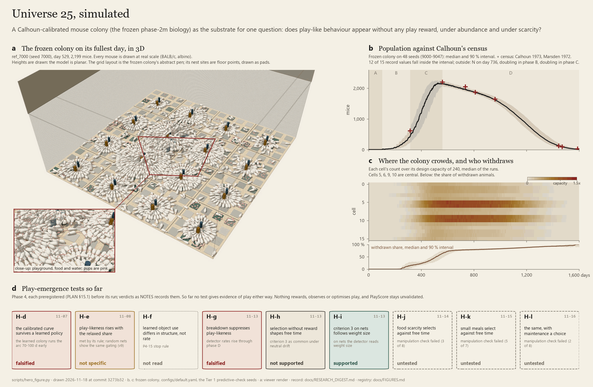

# Figures

The figures this repo keeps: what each shows, what it does not claim, and how to remake it.
Redraw a figure whenever a number it shows changes. The JSON beside each figure records what it
was drawn from: commit, seeds, the checks it ran and the renders it used.

## Hero figure: `docs/figures/hero.png`

**What it shows.**
- **a.** The frozen colony on its fullest daily frame in the viewer's 3D view.
  - The recording is `ref_7000` (`configs/default.yaml`, seed 7000): day 529, 2,199 mice.
  - The close-up shows the playground and the crowds at food and water.
  - Every mouse is drawn at real scale, as an albino mouse (the founders were BALB/c).
- **b.** Population of the frozen colony on the 48 seeds of the Tier 1 predictive check
  (9000–9047; NOTES 2026-11-09), as median and 90 % interval.
  - The red crosses are Calhoun's census (Calhoun 1973; Marsden 1972).
  - The figure counts how many of the record's 15 values fall inside the interval, and names
    the ones that do not.
- **c.** Where the colony crowds, on the same 48 runs. Each cell's count is shown over its
  design capacity (240), as a median. Below it is the share of withdrawn animals.
- **d.** The phase-4 play-emergence tests and their verdicts, from
  `docs/figures/phase4_ledger.yaml`.

**What it does not claim.**
- **Panel a is a picture of the model.**
  - It is not Calhoun's apparatus. The grid layout is the frozen colony's abstract pen. Its
    nest sites are floor points, drawn as low pads.
  - The simulator is planar, so heights are drawn.
  - Its mice are points that pass through anything. The drawing keeps each body clear of the
    walls and the playground's objects, and spreads the objects the mice push into heaps.
  - The crowds the model puts on one point (at food and water, on a nest) are laid out by the
    drawing, and bodies that still overlap are drawn lying on one another.
  - NOTES 2026-11-17 (the 3D view) lists what the drawing chooses.
- **Panel b shows a fit, not a prediction.** The parameters were calibrated to these
  landmarks on other seeds. With the playground off, or in Calhoun's own pen layout, the same
  biology fits worse (README, "How close is it to the original?").
- **Calhoun's phases A–D are shaded on the record's days.** They are not detected in the runs.
- **The 48 seeds were read before**, for the Tier 1 predictive check. The figure re-runs them to
  get the daily series. `collect` checks each run's landmarks against
  `_output/calib_reference/rows.json`. No new decision is made on them.
- **"Withdrawn" is the model's role 6** (low competence). It is an analogue of the record's
  "beautiful ones", not a measurement of them.
- **Panel d gives the verdicts as NOTES records them.**
  - H-i's "supported" is a property of the detector on nets, not play.
  - PlayScore stays unvalidated, and nothing rewards, observes or optimises play.

**How to remake it.**
1. **Panel a.** Run `python scripts/viewer_serve.py`, then open
   `http://127.0.0.1:8765/?rec=ref_7000&shot=hero`.
   - This needs `_output/viewer/ref_7000.u25`; the README section "Viewer" has the recording
     command.
   - It writes `_output/figures/hero_pen.png`, `hero_close.png` and `hero_shot.json`.
2. **Runs.** `python scripts/hero_figure.py collect --workers 8` makes the 48 runs of 1,600
   days, about 6 minutes on 8 workers, cached in `_output/hero/`.
3. **Draw.** `python scripts/hero_figure.py draw` writes `docs/figures/hero.png` and `hero.json`.
   It also copies fresh renders into `docs/figures/src/` as JPEG, so that later redraws need no
   browser.

**When to redraw.**
- A phase-4 test is read: add it to `phase4_ledger.yaml` first.
- The frozen colony or the record's landmarks change (`src/universe25/metrics/calibration.py`).
- The viewer's drawing changes: shoot panel a again.

**Changes.**

| date | change |
|---|---|
| 2026-11-17 | First version: render, predictive-check population, crowding and withdrawal, the H-d to H-l ledger. |
| 2026-11-17 | Panel a re-shot after the 3D view stopped drawing mice through walls: the grid's nest sites as pads, bodies kept clear of walls and objects. No number changed. |
| 2026-11-18 | Panel a re-shot after the 3D view stopped drawing crowded mice through one another: crowds laid out, overlaps drawn as mice lying on one another. No number changed. |

## Booklet: `docs/booklet/universe25_booklet.pdf`

A nine-page A4 introduction for people outside the repo. The pages cover:
1. the cover;
2. the record;
3. the model;
4. the hero figure;
5. the predictive check;
6. how close the model is to the original;
7. the play question and its tests;
8. earlier research;
9. how to explore.

**Files.**
- `docs/booklet.html` is the page the PDF is printed from.
- `scripts/booklet.py` writes both. Edge or Chrome, run headless, prints the PDF.

**What is generated, and what is written.**
- *Generated:* the predictive-check table, the ledger of tests, the render's day and count, and
  the edition stamp. They come from `docs/figures/hero.json` and `phase4_ledger.yaml`.
- *Written by hand* in `scripts/booklet.py`: the prose about the record, the model and earlier
  research. It follows `docs/RESEARCH_DIGEST.md`, README and `docs/PRIOR_WORK.md`, and changes
  when they do.

**How to remake it.** Remake the hero figure first, then run `python scripts/booklet.py`.
`python scripts/booklet.py --check` says whether `docs/booklet.html` is current, and
`tests/test_booklet.py` (fast tier) fails when it is not.

**When to remake it.**
- Whenever the hero figure is redrawn.
- Whenever the prose it summarises changes: the record, the model's status, earlier research.

| date | change |
|---|---|
| 2026-11-17 | First edition, from the hero figure drawn at 8ed9d3f. |
| 2026-11-17 | Page 6 added: how close the model is to the original. The pen compared; the fit is fitted; closer to the original fits worse; the behaviour does not match. |
| 2026-11-17 | Remade with the re-shot render (mice no longer drawn through walls). |
| 2026-11-18 | Remade with the re-shot render (crowded mice no longer drawn through one another). |
